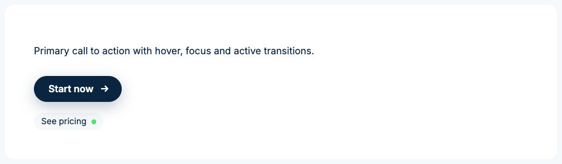
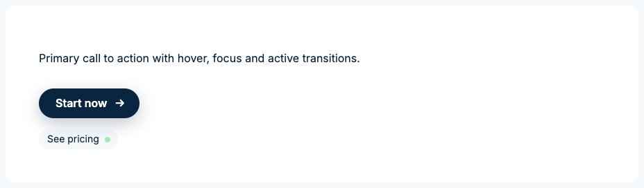
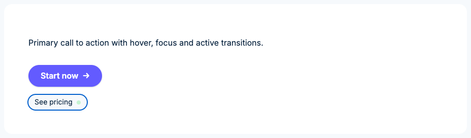
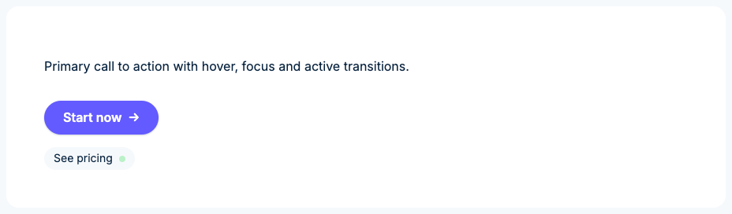
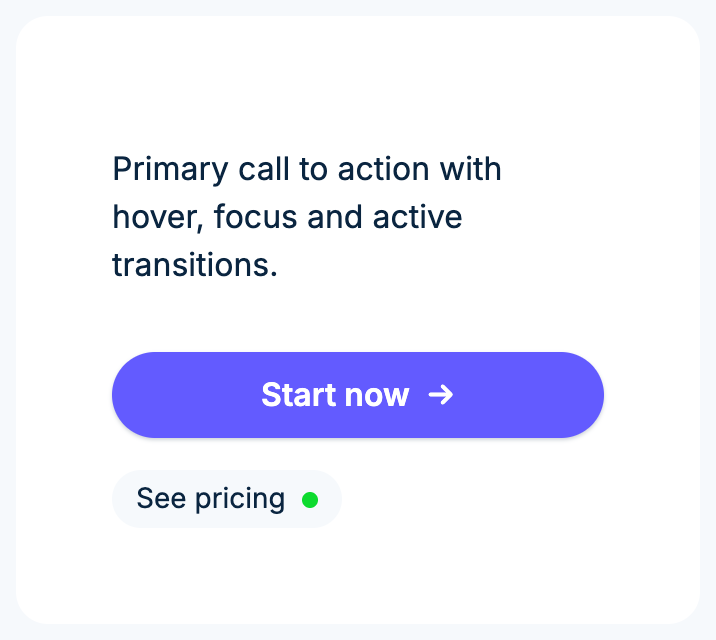
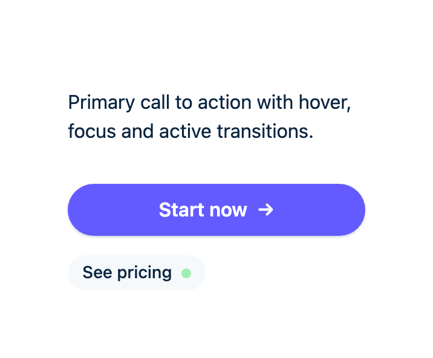
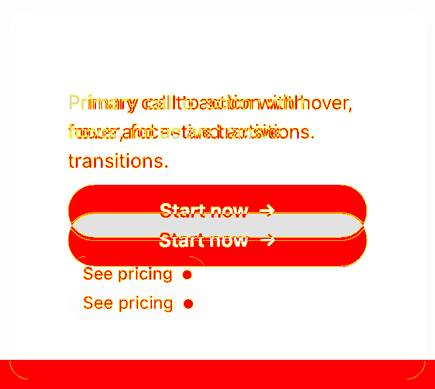

# Preview diff

Rendered 2026-11-24T21:20:55.381Z. Threshold: 10.0% of pixels. Over the threshold in 1 of 8 states.

| state | score | size (original → rebuild) | original | rebuild | diff |
| --- | --- | --- | --- | --- | --- |
| default | 0.9% | 928×272 → 928×272 |  |  |  |
| hover-0 | 0.9% | 928×272 → 928×272 |  |  |  |
| focus-0 | 0.9% | 928×272 → 928×272 |  |  |  |
| active-0 | 0.9% | 928×272 → 928×272 |  |  |  |
| hover-1 | 0.9% | 928×272 → 928×272 |  |  |  |
| focus-1 | 0.9% | 928×272 → 928×272 |  |  |  |
| active-1 | 0.9% | 928×272 → 928×272 |  |  |  |
| mobile | 18.4% (over) | 716×640 → 716×592 |  |  |  |

Score is the share of pixels that differ (pixelmatch, colour tolerance 0.1) on a canvas the size of the larger image, so a size difference counts as mismatch. Red pixels in each diff image mark the mismatches. Screenshots are the component's box plus 8 px, with each state forced on the same element as in the original. The rebuild is laid out at the original root's width (and, for mobile, at the width it had in a 390 px viewport).

Compare the motion too: [original.webm](original.webm) and [Component.preview.webm](Component.preview.webm).
